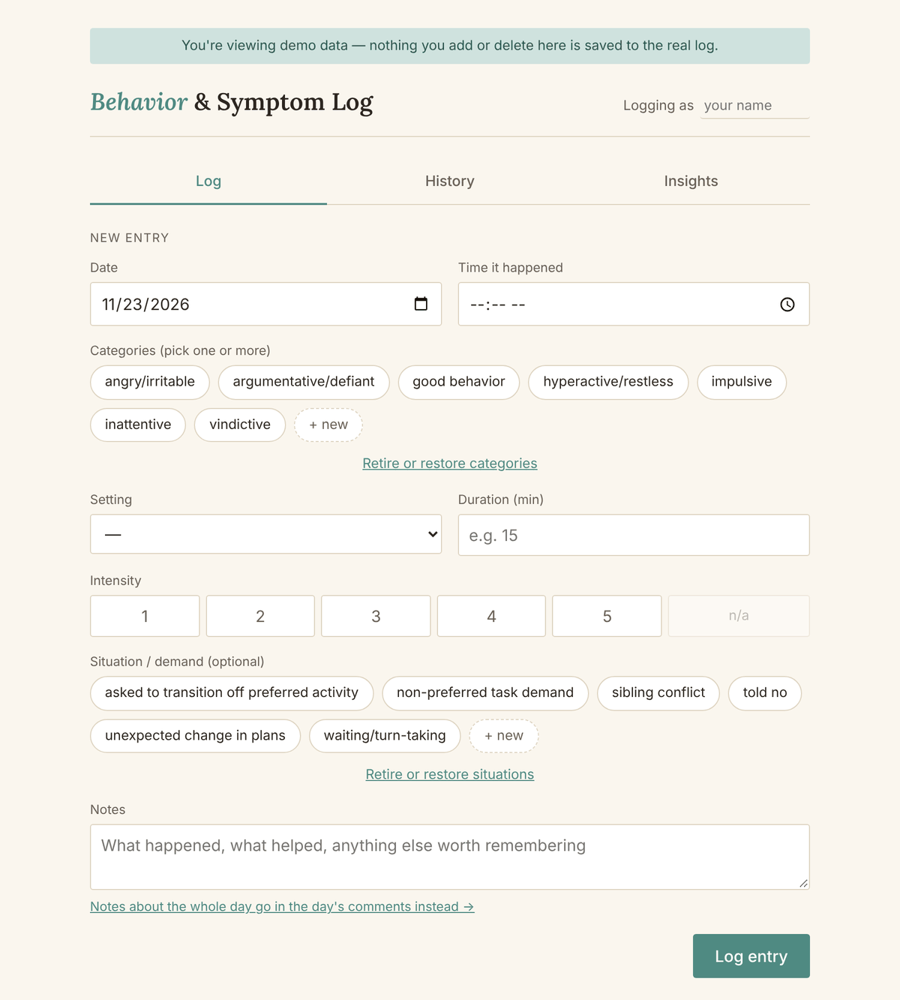
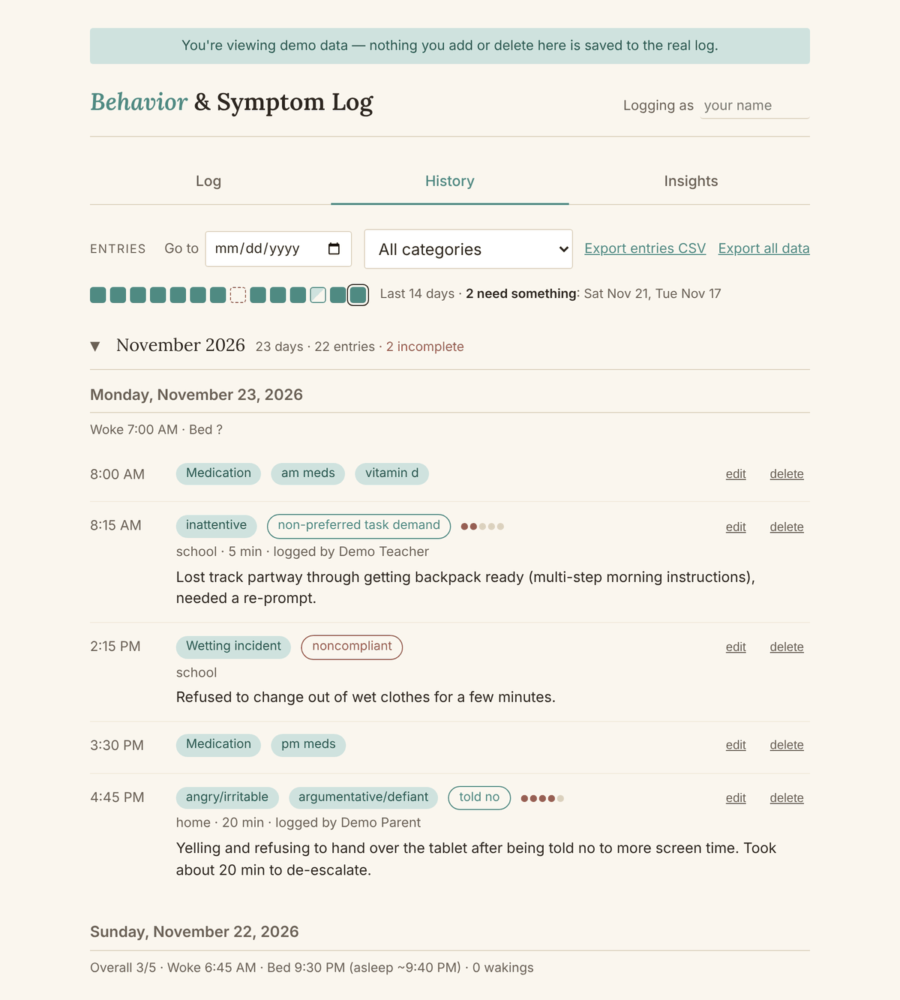

# Behavior & Symptom Log 🧠📋 #
A shared web app for logging behavioral patterns for a neurodivergent kid. Any caregiver — parents, a babysitter, a teacher — can log an entry from their own device, and the history stays in one place, filterable and exportable for appointments or school meetings.

## Try It ##
Live at [behavior-tracker-st8g.onrender.com](https://behavior-tracker-st8g.onrender.com/) — log in with `demo` / `demo` to click around with sample data: about two months of made-up days, so every Insights chart has something to show. Demo logins are fully interactive (add, filter, delete) but run on an isolated in-memory dataset, so nothing you do there ever touches the real log. First load can take 30–60 seconds if the site's been idle (free hosting sleeps when nobody's using it) — that's normal, not broken.

## Screenshots ##
All from the demo login, so everything shown is made up.

| Log | History |
|---|---|
|  |  |

## What It Tracks ##
- [x] Shared Logging: any household device can add entries, no install or account creation required
- [x] Custom Categories: seeded with an evidence-based taxonomy matched to this kid's actual evaluated profile — DSM-5 ODD's three clusters (angry/irritable, argumentative/defiant, vindictive) plus the three ADHD presentations (impulsive, inattentive, hyperactive/restless) — add your own on the fly
- [x] Retire, Don't Delete: categories and situations that no longer fit can be retired — they leave the picker but stay on (and filterable in) the entries that used them, and can be restored any time. Wetting accidents are logged as wetting incidents, not as a behavior category
- [x] Multi-Category Tagging: tag one entry with more than one category at once (e.g. angry/irritable + argumentative/defiant)
- [x] Situation/Demand Tagging: optionally tag what was going on right before (told no, a non-preferred task demand, sibling conflict, an unexpected change in plans, etc.) from a growable structured list, so situations can be clustered and compared instead of living in unstructured freeform text
- [x] Rich Entry Detail: date, time it happened (required, never defaulted to the logging time), setting, duration, 1–5 intensity scale (automatically n/a for positive "good behavior" entries), freeform notes, and who logged it (required)
- [x] Editable Logging: update a behavior entry, wetting incident, or medication dose after the fact instead of deleting and relogging it. Changing the date while editing moves the record, and the button says so ("Update and move to Sun Nov 15")
- [x] Never the Wrong Day by Accident: when the Daily Context date isn't today (after filling in an earlier day, or in a tab left open overnight), the add buttons name the day they'll save to ("Add to Sun Nov 15") instead of just "Add incident"
- [x] Daily Context: separately track how the day went (a one-tap "had a good day" marker, so a quiet day is distinguishable from a day nobody logged, plus an optional 1–5 overall rating and comments about the whole day — shown on the day, and linked from the entry form so day summaries don't end up in a single behavior entry), sleep (wake time, bedtime, time actually fell asleep, and night awakenings — with an explicit "None" so a blank means not recorded) once per day, plus wetting incidents (time — marked as either when it happened or, approximately, when it was noticed — location, response — compliant/noncompliant/not observed/other — and optional details) and medication doses (time, one or more medications taken together, optional details) any number of times per day, independent of how many behavior entries that day has — shows up alongside that day's entries when logged, including on days with no incidents at all
- [x] Medication Tracking: log any number of doses per day from a growable list of medications — pick several in one entry when they're taken together — add-your-own on the fly like categories/situations — dose lives in the name (e.g. "Methylphenidate 10mg"), so a dose change is logged as a new medication rather than a rename, keeping history accurate. Meds no longer in use can be hidden from the picker without deleting them or their history. A dose can be logged as taken or explicitly as skipped — a day with nothing logged means missing data, not a skipped dose. Times copied from the day before ("same as previous day") are marked unconfirmed (shown as "~8:30 AM") until someone confirms them with one tap or edits the time, so dose-timing analysis can tell observed times from assumed ones
- [x] Context Log: dated events for slow-moving things nothing else captures — illness, school breaks and days off, schedule changes, visitors/travel, medication or dose changes — from a growable list of kinds. Events can span several days and show on each day they cover ("day 2 of 4"), so a rough stretch can be lined up against what was going on
- [x] What's Missing: a 14-day strip and per-day chips flag anything expected but not logged (wake-up time, bedtime, a day rating, usual medications), including days with nothing logged at all — tap a chip to fill it in, mark a dose as skipped, or mark a day as "nothing more to add". Quiet by design: complete days look the same as before
- [x] Day-Grouped History: entries organized chronologically, newest first, in collapsible months (and past years) so the log stays scannable as it grows
- [x] Category Filtering: narrow the log down to one category at a time
- [x] Go to Date: pick a date to show just that day (or the nearest day with anything logged), then "Show all days" to return to the full list at that spot
- [x] CSV Export: pull the behavior log (or a filtered slice) for appointments or school meetings
- [x] Full Data Export: one click downloads a zip with a tidy CSV per table (behavior entries, daily context, wetting incidents, medication doses, context events) — opens in Excel, loads straight into pandas, and doubles as a manual backup (also available at `GET /api/export`)
- [x] Shared Login: household-wide password gate so the log isn't wide open to the internet
- [x] Read-Only Login: an optional second login (`VIEWER_PASSWORD`) that can see and export the real log but not change it — for a co-parent, grandparent, or clinician. The server refuses every write from that login; the page just hides the editing controls
- [x] Demo Mode: a separate login serves sample data so anyone can see how it works without seeing (or risking) the real log: a hand-written recent week plus about two months of generated days (a rough stretch, a good one, a school break, a trip left out of Insights, a medication change), the same on every load
- [x] Tabs: Log, History and Insights, with the tab in the URL so refresh, bookmarks and the back button keep your place
- [x] Insights, phase line: the day rating's 7-day average (with and without "good day"-only days), daily behavior-entry counts shaded by that day's highest intensity, the night before each day's sleep (bedtime, falling asleep, waking), context events and medication changes on one timeline; recomputed every time the tab opens, with a table view
- [x] Real Zeros: a rated day with no behavior entries gets a mark on the baseline, so "nothing happened" looks different from "nobody logged". Tapping a day also shows good-behavior entries, night wakings, skipped doses and the day's comments
- [x] Enough Data Yet?: a counter of days with both a real rating and the night before's sleep, within the current medication regimen, against the ~60 where comparing sleep with the next day starts to be worth trying; until then the page says any pattern is a hunch
- [x] Leave out of Insights: a context event (say, a trip abroad) can be marked so its days are left out of every average. The data is kept, the days show as a hatched gap rather than being joined across, and a toggle shows them again
- [x] Insights, wetting: one dot per incident on the same timeline, filled by how changing went (resisted, changed without a fight, not seen), with time, setting and happened/noticed in the day readout, plus weekly totals split the same way; weeks that weren't fully logged are faded, so a gap never reads as a dry week. Each chart (day rating, behavior, wetting, wetting by week, sleep) can be shown or hidden
- [ ] More insights: time of day (with "happened" and "noticed" times kept apart), frequency by category, common situations/demands, reconstructed past phases; sleep and medication-timing comparisons once there's enough data
- [ ] Automated Backups: beyond the manual CSV export
- [ ] Per-Person Accounts: currently one shared household login
- [ ] Custom Trackers: user-defined trackers (day-level like sleep, or event-level like wetting/medications) with typed fields, so diagnosis-specific presets can ship their own tracked metrics

## Analysis ##
`analysis/` turns a data export into tidy tables for pattern-finding, with every data-cleaning rule written down as a numbered step (see `analysis/README.md`). Only code and generic rules live in the repo; exports, record-specific overrides, built tables and notebooks stay in the gitignored `Claude outputs/` folder.

The app's **Insights** tab runs the same package on the server (`GET /api/insights`), on the same CSVs an export produces, so the app and the notebooks can't disagree. Record-specific overrides reach the server through the `ANALYSIS_OVERRIDES` environment variable (paste the contents of `overrides.json`); without it the generic rules still apply. Overrides only change what Insights counts, never the log itself. Two things to know when updating it on Render:
- The app reads it once at startup, so use **Save and deploy**, not "Save only". The change then shows as its own row in the service's Events.
- Unknown keys are rejected and then *no* overrides apply (the tab shows a warning). If a code change adds a new override key, deploy the code first, then the new value.

## Architecture ##
Caregiver's Device → FastAPI Backend → Postgres (Neon) → Shared History Across All Devices

## Tech Stack ##
### Backend
- Python 3.12
- FastAPI (web framework) with Pydantic (request validation)
- Uvicorn (ASGI server)

### Database
- PostgreSQL, hosted on Neon (serverless, free tier)
- psycopg2

### Hosting
- Render (free web service)
- Neon (free Postgres)

### Frontend
- HTML/CSS (warm, non-clinical styling — paper background, serif headings, no cards or shadows)
- Vanilla JavaScript, no build step
