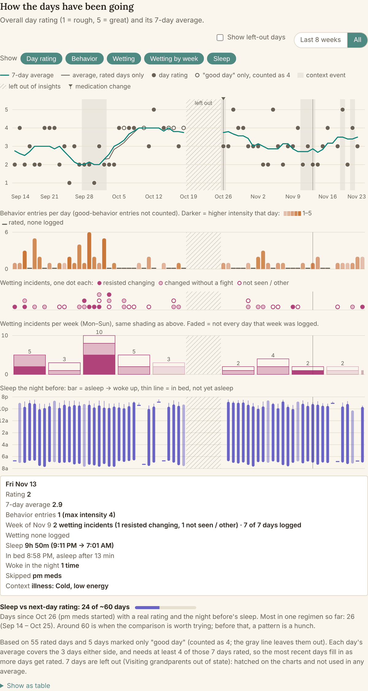

# Behavior & Symptom Log 🧠📋

A shared web app for logging a neurodivergent kid's behavior, sleep, medications and wetting, so any caregiver (parents, a babysitter, a teacher) can log from their own phone and the history stays in one place, ready for appointments, school meetings, and looking for patterns over weeks rather than days.

**Try it:** [behavior-tracker-st8g.onrender.com](https://behavior-tracker-st8g.onrender.com/), log in as `demo` / `demo`. That's about two months of made-up data, fully clickable, and nothing you do touches the real log. Free hosting sleeps when idle, so the first load can take up to a minute.

More: [Log](docs/screenshots/log.png) · [History](docs/screenshots/history.png) (all demo data)

## What it does

- **Log behavior** with categories, the situation right before, setting, duration and 1–5 intensity
- **Daily context:** how the day went, sleep, wetting incidents, medication doses, and dated events (illness, school breaks, travel, medication changes)
- **What's missing:** a 14-day strip flags anything expected but not logged, so a quiet day and a forgotten day look different
- **History** grouped by day, filterable, with CSV and full-data export
- **Insights:** a 7-day phase line with behavior, wetting and sleep on one timeline, honest about how much data it has
- **Logins:** a shared household login, an optional read-only one (co-parent, clinician), and a demo login

## Docs

- [Using it](docs/using.md): every feature, tab by tab, and how to read the Insights charts
- [Running it](docs/running.md): deploying on Render and Neon, environment variables, running locally, tests
- [Decisions](docs/decisions.md): the non-obvious calls and why they were made
- [Analysis](analysis/README.md): how an export becomes tidy tables, one numbered rule at a time

## Stack

Python 3.12 · FastAPI · Postgres on Neon · Render · vanilla HTML/CSS/JS, no build step. The Insights tab runs the same `analysis/` package as the notebooks, so the app and the analysis can't disagree.

## Roadmap

- More insights: time of day (with "happened" and "noticed" kept apart), category and situation breakdowns, reconstructed past phases; sleep and medication-timing comparisons once there's enough data
- Automated backups beyond the manual export
- Per-person accounts instead of one shared login
- Custom trackers with typed fields, so diagnosis-specific presets can bring their own metrics
